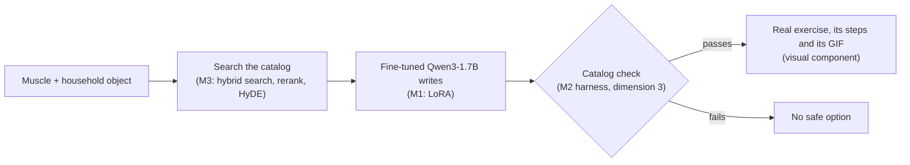

# MacGyver Gym Rat

**In one sentence:** MacGyver Gym Rat helps someone who planned to train a muscle but has no
gym equipment decide which real catalog exercise to do with a household object they already
have (a water bottle, a backpack), or tells them honestly when nothing safe fits, so they do
not improvise something that does not train the muscle or could hurt them.

| | |
|---|---|
| **Live demo** | <https://huggingface.co/spaces/jayoungh/macgyver-gym-rat> (Hugging Face ZeroGPU Space). Pick a muscle and an object from the lists. Signing in to Hugging Face gives a larger daily GPU quota (5 min a day, 2 without signing in; one request uses about 10 s). |
| **W&B project** | <https://wandb.ai/jayoungh-me/macgyver-gym-rat-m5>: latency per request, recommendations against refusals, filter blocks and which components ran. One run per start of the Space. Without `WANDB_API_KEY`, W&B is a silent no-op and the app still runs. |
| **Final report** | [`final/reporte.md`](final/reporte.md): problem and user, system diagram, decisions, evolutionary table, ablation, error analysis, limitations, ethics, who did what, AI use. |
| **Slides** | [`final/slides`](final/slides/slides/sustentacion-final/index.tsx), built with open-slide (`cd final/slides && npm install && npm run dev`). |

## How it works

A LoRA fine-tuned `Qwen3-1.7B` never answers on its own. It first looks the request up in a
catalog of 1,324 real exercises, writes a recommendation from what it found, and the answer
is checked against the catalog before anyone sees it. If the check fails, the user gets an
honest "no safe option" instead of an invented exercise.



The Space adds a health check, one JSON log line per request (no personal data) and W&B
metrics. Details in [`final/deploy/README.md`](final/deploy/README.md).

## Results at a glance

Same 14-case eval set and the same harness for every row. The number we trust is the
**domain hit rate**: the exercise exists in the catalog, trains the muscle asked for, and
works with the object (or the system correctly refuses).

| System | Domain hit rate | Median latency | Compared with |
|---|---:|---:|---|
| Qwen3-1.7B, no fine-tuning | 0.0% | | the starting point |
| LoRA fine-tuned, no retrieval (M2 baseline) | 21.4% | 7.9 s (T4) | +21.4 pts over no fine-tuning |
| + naive RAG | 7.1% | | worse: retrieval alone misleads it |
| **+ advanced RAG (M3, deployed)** | **42.9%** | 15.2 s (T4) | **2x the baseline**; trap cases 0 → 3 of 4 |
| + agent with a tool | 28.6% | 38.9 s (T4) | slower and worse, so not deployed |
| advanced RAG with the generator in int4 (M5) | 21.4% | 48.0 s vs 17.9 s (RTX 4060) | failed the loss budget, so the Space serves 16 bits |

On the live system, 3 of the 14 eval cases come back with the exercise's GIF. Over 60
muscle-object pairs outside the eval set it refused all 11 impossible ones and never showed an
invented exercise, but it only answered 7 of the 49 answerable ones: it prefers saying no to
making something up. Sources: `reports/` and [`final/efficiency/RESULTS.md`](final/efficiency/RESULTS.md).

## How to run it

```bash
# 1. Clone with the exercise catalog submodule (pinned at commit 8872272)
git clone --recurse-submodules https://github.com/iamcroody/JoseJimenez-JuanYoung-AlbertoCervantes-DavidCuadros.git
cd JoseJimenez-JuanYoung-AlbertoCervantes-DavidCuadros

# 2. Install the dependencies (needs uv: https://docs.astral.sh/uv/)
uv sync

# 3. Self-tests that need no GPU and download no model weights
uv run python eval/harness.py
uv run python m3/selftest.py
uv run python final/efficiency/selftest.py
uv run python final/deploy/selftest.py
```

- **Full runs (GPU):** open a module's notebook on a free Colab T4 (*Runtime → Change runtime
  type → T4 GPU*) and run every cell. The setup cell clones this repo, so nothing needs
  uploading (M1 clones the branch `FinetuningEntregaM1`; M2, M3 and M5 clone `main`). M3 takes
  about an hour. Seeds are fixed (42) and decoding is greedy.
- **The demo without the Space:** run `final/deploy/app.py` on a Colab T4 with `SHARE=1` for a
  public Gradio link ([`final/deploy/README.md`](final/deploy/README.md)).
- **Every command, module by module:** [`docs/SETUP.md`](docs/SETUP.md). Pinned versions and the
  run order behind each `reports/*.csv`: [`final/REPRODUCIBILITY.md`](final/REPRODUCIBILITY.md).

## Index

| Module | Question it answers | Headline | Write-up | Notebook (Colab T4) |
|---|---|---|---|---|
| M1 · Fine-tuning | Can LoRA teach a 1.7B model to name a real exercise for a household object? | Constraint satisfaction on the held-out test split: 0.0% zero-shot, 18.5% with LoRA. It does not refuse. | [`docs/modules/M1.md`](docs/modules/M1.md) | [`M1_macgyver.ipynb`](notebooks/M1_macgyver.ipynb) |
| M2 · Evaluation harness | How do we measure that without being fooled by fluent answers? | Three dimensions on 14 cases. The LLM judge rated the worse system higher, so the catalog-based hit rate is the number we trust. | [`docs/modules/M2.md`](docs/modules/M2.md) | [`M2_harness.ipynb`](notebooks/M2_harness.ipynb) |
| M3 · Agentic RAG | Does retrieving from the catalog fix the invented exercises? | 21.4% → 42.9% with advanced RAG; the agent tool drops it to 28.6%. | [`docs/modules/M3.md`](docs/modules/M3.md) | [`M3_rag.ipynb`](notebooks/M3_rag.ipynb) |
| M5 · Efficiency and deployment | Can we make it cheaper to run and ship it safely? | int4 saves 44% of VRAM but halves the hit rate and loses the refusals; the Space serves 16 bits. | [`docs/modules/M5.md`](docs/modules/M5.md) | [`M5_efficiency.ipynb`](notebooks/M5_efficiency.ipynb) |

The findings, in plain words, are in the *Honest reading* of
[M2](docs/modules/M2.md#honest-reading) and [M3](docs/modules/M3.md#honest-reading).
Also: the final integrator [`final/`](final/README.md), the dataset and its known biases
[`docs/DATASET.md`](docs/DATASET.md), and the raw results in `reports/` (scorecards as CSV,
per-case detail as JSON).

## Repository layout

```text
data/exercises-dataset/   exercise catalog (git submodule, pinned)
scripts/                  M1: dataset build, scorer, zero-shot baseline, LoRA training
models/r16-all-linear/    M1: the trained LoRA adapter
eval/                     M2: harness, eval set and judge rubric
m3/                       M3: retrieval, agent and the four systems
final/                    M5: efficiency, deployment (app + Space), CI smoke, report, slides
notebooks/                one Colab notebook per module
reports/                  every scorecard and measurement, as CSV and JSON
docs/                     dataset card, project definition, module write-ups, setup
```

## Team and credits

Juan Andrés Young Hoyos, José Alejandro Jiménez Vásquez, David Cuadros Mariño and Alberto
Daniel Cervantes Forero (SI4006, Universidad EAFIT). Who did what is in
[the report](final/reporte.md#9-quién-hizo-qué).

The catalog is the [exercises dataset](https://github.com/jayounghoyos/exercises-dataset)
(1,324 exercises, instructions in 10 languages). Exercise media is © [Gym visual](https://gymvisual.com/)
and is referenced, not redistributed here; see the dataset repo's `NOTICE.md`.

**AI use.** All four of us used Claude (Anthropic) for code, debugging, analysis, writing and
the slides, and we read and ran what it produced before keeping it. The full declaration is in
[the report](final/reporte.md#10-uso-de-ia).
