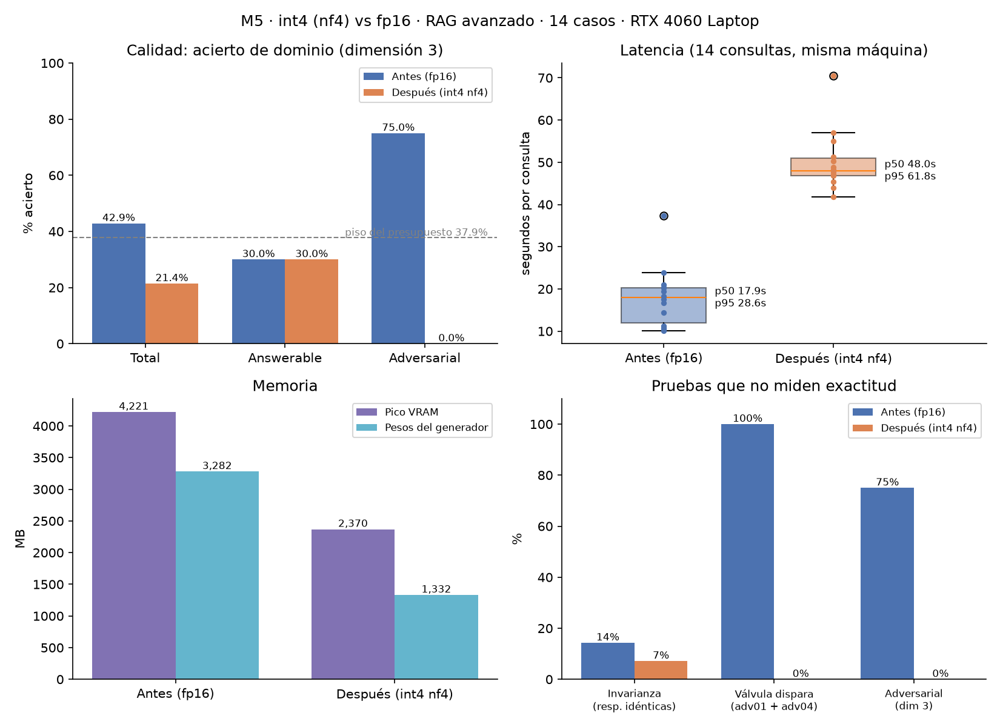

# Resultados de eficiencia (Módulo 5): int4 (nf4)

> **Estado: medido.** Las cifras salen de `reports/efficiency_m5.csv` y
> `reports/efficiency_m5_detail.json` (latencia por consulta, scorecards
> completos y pruebas de válvula, invariancia y adversarial). La gráfica
> `img/efficiency_m5.png` se regenera con `plot_m5.py` desde el JSON.

## Presupuesto de pérdida aceptable (fijado ANTES de medir)

Aceptamos perder hasta **5 puntos** de tasa de acierto de dominio (dimensión 3)
en el sistema de **RAG avanzado** (bajar de **42.9 %** a no menos de **37.9 %**)
siempre que int4:

- reduzca el **pico de VRAM** por debajo de la huella fp16, y
- **no aumente** la latencia **p95** respecto de la versión fp16.

**¿Se cumplió el presupuesto?** **NO.** Se cumplió solo la condición de memoria
(el pico de VRAM baja de 4 221 MB a 2 370 MB). Las otras dos fallaron: la
dimensión 3 cayó **21.4 puntos** (de 42.9 % a 21.4 %, cuatro veces más que lo
aceptado) y la latencia p95 **subió** de 28.6 s a 61.8 s.

## Condiciones de la medición

- Mismo eval set congelado: `eval/eval_set.json` (14 casos, 4 adversariales).
- Mismo harness congelado: `eval/harness.py` (3 dimensiones).
- Sistema medido: `sistema_rag_avanzado` (RAG avanzado: híbrido + rerank + HyDE,
  prompt v2a, top 8) sobre cada generador. El recuperador es el mismo objeto
  para las dos filas, así que la única variable es la cuantización.
- Misma máquina para las dos filas: **NVIDIA RTX 4060 Laptop (8 GB)**, torch
  2.14.1+cu130, transformers 5.16.1, peft 0.20.0, bitsandbytes 0.50.2, seed 42,
  decodificación greedy.
- El generador "antes" se forzó a **fp16**, que es lo que `pick_device_dtype`
  elige en un T4. En una GPU Ada elegiría bf16 y la fila "antes" ya no sería la
  de M3.
- El juez (Qwen2.5-1.5B) corrió en **CPU (fp32)** para que generador y juez
  cupieran en 8 GB sin desbordar a memoria compartida. La latencia se cronometra
  **antes** de que corra el harness, así que el lugar del juez no toca las
  columnas de latencia.
- Latencia: 14 consultas cronometradas por versión (más una de calentamiento que
  no cuenta), agregadas con `numpy.percentile` (p50 y p95).
- Memoria: `torch.cuda.max_memory_allocated` (pico de VRAM durante la pasada de
  latencia + harness) y la huella de pesos del generador.
- Script: `final/efficiency/run_local.py <raíz del repo>` ejecuta las mismas
  celdas de `notebooks/M5_efficiency.ipynb` con esos dos ajustes. Tardó 13 min
  la fila fp16 y 26 min la int4.

**Control de la medición.** La fila "antes" reproduce M3: los mismos 6 aciertos
de dimensión 3 (42.9 %; 30 % answerable, 75 % adversarial) que
`reports/scorecard_m3.csv` (`rag_advanced`), y 9 de las 14 respuestas son
idénticas carácter por carácter a `reports/replies_m3.json`. Las otras 5 cambian
algunas palabras por la diferencia de GPU (Turing contra Ada) en fp16, sin cambiar
ningún acierto. Por eso dimensión 1 y 2 se mueven un poco respecto de M3 (0.739
contra 0.705; 2.71 contra 2.43, este último también porque el juez corrió en CPU).

## Tabla antes/después

| Versión | Calidad (harness, dim 3) | Latencia p50 | Latencia p95 | Memoria / tamaño |
| --- | ---: | ---: | ---: | ---: |
| Antes (M4/M3, fp16) | **42.9 %** | **17.9 s** | **28.6 s** | VRAM pico 4 221 MB / pesos 3 282 MB |
| Después (int4 nf4) | 21.4 % | 48.0 s | 61.8 s | **VRAM pico 2 370 MB / pesos 1 332 MB** |

Detalle de calidad:

| Métrica | fp16 | int4 |
| --- | ---: | ---: |
| Dim 3 · answerable (10) | 30 % | 30 % |
| Dim 3 · adversarial (4) | **75 %** | **0 %** |
| Dim 1 · similitud | 0.739 | 0.737 |
| Dim 1 · step grounding (ROUGE-L) | 1.000 | 0.962 |
| Dim 2 · juez (1-5) | 2.71 | 4.57 |

Los aciertos answerable son 3 en las dos filas, pero **no son los mismos casos**:
fp16 acierta upper back, abs y levator scapulae; int4 acierta biceps, triceps y
pectorals (los tres que fp16 rechazaba con contexto válido) y pierde los otros
tres.

## Pruebas que no miden exactitud, sobre int4

| Prueba | fp16 (referencia) | int4 |
| --- | ---: | ---: |
| Invariancia (fracción de 14 respuestas idénticas bajo perturbación trivial) | 14 % (2/14) | 7 % (1/14) |
| Válvula de escape dispara en adv01 y adv04 | **Sí, en las dos** | **No, en ninguna** |
| Bloque adversarial adv01..adv04 (dimensión 3) | 75 % (3/4) | 0 % (0/4) |

Lo que hizo int4 en cada adversarial: adv01 (par imposible) y adv04 (barra de
cortina) respondió con un ejercicio en vez de rechazar; adv02 siguió la premisa
falsa sin corregirla; adv03 no declinó la parte fuera de dominio (dosificación).

## Lectura

- **Memoria: int4 cumple.** Pesos del generador −59 % (3 282 → 1 332 MB) y pico
  de VRAM −44 % (4 221 → 2 370 MB).
- **Velocidad: int4 es 2.7 veces más lento**, no más rápido (p50 17.9 → 48.0 s,
  p95 28.6 → 61.8 s). bitsandbytes guarda los pesos en 4 bits y los descomprime en
  cada paso de generación; con un modelo de 1.7B y una consulta a la vez, ese
  trabajo extra pesa más que lo que ahorra mover menos memoria. Todas las 14
  consultas son más lentas, no es un valor atípico.
- **Calidad: pierde 21.4 puntos**, y toda la pérdida está en los adversariales.
  int4 contesta igual de bien los casos con respuesta (30 %), pero **perdió la
  capacidad de decir "no sé"**: la válvula no dispara en ningún caso y el bloque
  adversarial pasa de 75 % a 0 %. Es justo el riesgo que la asignación pedía
  revisar: el modelo chico acierta lo mismo y deja de rechazar.
- **El juez sube de 2.71 a 4.57, y eso es el sesgo, no una mejora.** El juez de
  1.5B premia contestar con seguridad: en los adversariales int4 inventa una
  respuesta fluida y el juez le da 5 donde fp16 rechazaba y recibía 1. Es el mismo
  sesgo medido en M2 y la razón por la que la tabla usa la dimensión 3.
- **Invariancia baja también en fp16 (14 %).** No es un efecto de int4: el
  sistema completo (HyDE + generación) ya cambia el texto ante perturbaciones
  triviales de la pregunta. int4 lo empeora un poco (7 %).

## Decisión

**No usamos int4 en producción.** El Space sirve el generador en 16 bits (bf16
en la GPU de ZeroGPU), que cabe sin problema en su memoria, y la versión int4
queda en el repo como experimento medido (`QUANTIZED=1` en el respaldo de
Colab). int4 solo valdría la pena si la memoria fuera el cuello de botella (una
GPU de 4 GB o menos); en este sistema no lo es, y lo que cuesta (la válvula y la
latencia) es lo que más importa para el usuario. Para un siguiente intento, la
pérdida de la válvula apunta a probar int8 (pierde menos precisión) o a
cuantizar con un método calibrado (AWQ/GPTQ) y volver a correr esta misma tabla.
