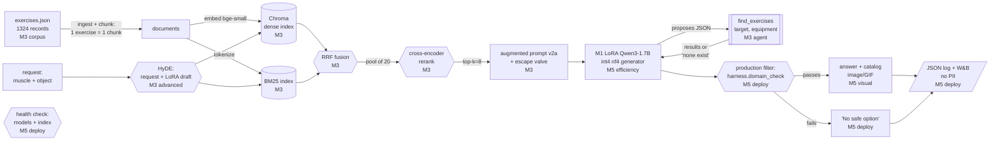

# Reporte final — MacGyver Gym Rat

> **Números en este reporte.** Todas las cifras concretas vienen de corridas ya
> ejecutadas y comiteadas en `reports/*.csv` / `reports/*.json`, de `docs/*.md` o
> de las tablas del `README.md` raíz. Las únicas cifras pendientes son las que
> solo puede producir una GPU: la tabla antes/después de eficiencia (fila
> "Sistema final"), el veredicto del presupuesto de pérdida, la URL del Space en
> vivo y el enlace de W&B. Esas van marcadas como TODO o "por completar (corrida
> T4)" y NO se inventan. Al final de este reporte hay una nota que separa qué
> salió de una corrida ejecutada y qué espera la corrida T4 del Módulo 5.
>
> Mismo eval set (`eval/eval_set.json`, 14 casos, 4 adversariales) y mismo
> harness (`eval/harness.py`, 3 dimensiones) en todas las filas de la tabla
> evolutiva; latencia medida en la misma máquina (Colab T4); nada de PII.

## 1. El problema y el usuario

**Quién es el usuario.** Alguien que ya tenía planeado entrenar un grupo
muscular ese día pero se queda sin el equipo de gimnasio que necesitaba:
viajando, en casa, o en cualquier lugar sin acceso al gimnasio. No quiere saltarse
el músculo ni improvisar algo que no lo entrena o que es inseguro
(`docs/PROJECT_DEFINITION.md`, sección 2).

**Qué decide con el sistema.** Qué ejercicio hacer para un músculo concreto
cuando no tiene el equipo necesario, usando solo un objeto casero que sí tiene
(por ejemplo: "quiero entrenar deltoides pero solo tengo dos botellas de agua
llenas"). Hoy, sin el sistema, lo más probable es que se salte ese músculo, haga
algo genérico que no lo entrena, o busque por su cuenta un sustituto improvisado
sin saber si funciona o si es seguro.

**La métrica de éxito de la DECISIÓN, no solo del modelo.** La métrica que
importa para la decisión del usuario es la **satisfacción de restricciones**: el
ejercicio recomendado tiene que existir de verdad en el catálogo, entrenar el
músculo pedido y ser realizable con la clase de equipo que el objeto sustituye.
Esta es la dimensión 3 del harness (tasa de acierto de dominio), y es la que el
equipo defiende por encima de la similitud por embeddings (dimensión 1) y del
juez LLM (dimensión 2), porque es la única que resuelve la respuesta contra el
catálogo real en vez de leerla.

La decisión tiene una segunda mitad que el modelo por sí solo cumple mal: **saber
cuándo no hay opción válida** y decirlo, en vez de inventar. Por eso el sistema
desplegado no entrega la salida cruda del modelo: un **filtro de producción**
(sección 7 de `docs/PROJECT_DEFINITION.md`) resuelve el ejercicio nombrado contra
el catálogo con la misma lógica de la dimensión 3 antes de mostrarlo, y si no
pasa, muestra "no safe option". La métrica de éxito de la decisión es, entonces,
"cuántas veces el usuario recibe un ejercicio que de verdad entrena su músculo con
su objeto, y cuántas veces recibe un rechazo honesto en lugar de una invención
peligrosa", no "qué tan fluida suena la respuesta".

## 2. El sistema en un diagrama

De la petición (músculo + objeto, y la imagen del catálogo en la respuesta) hasta
la respuesta mostrada al usuario. Cada pieza está etiquetada con el módulo del que
viene (M1 fine-tuning, M3 RAG agéntico, M5 eficiencia + despliegue).

**Cómo leerlo.** La ruta M3 (azul conceptual: ingest, índices, HyDE, RRF,
rerank, prompt v2a con válvula, herramienta `find_exercises`) es la del sistema
avanzado/agente que M3 ya mide. M5 agrega dos cosas alrededor del generador: lo
carga en **int4 (nf4)** para abaratar la pieza más lenta (eficiencia), y envuelve
la salida con el **filtro de producción**, el **componente visual** (imagen/GIF
del catálogo), el **health check**, el **logging JSON sin PII** y la
**observabilidad W&B** (despliegue). El sistema naive es la misma ruta sin HyDE,
sin BM25, sin rerank y sin herramienta. Ver el diagrama y el detalle de cada
pieza en `README.md` (secciones M3 y M5).

## 3. Decisiones técnicas (con alternativas descartadas)

Resumen; el detalle con las mediciones está en `docs/RESULTS_REPORT.md`,
`docs/DATASET.md` y las secciones M3/M5 del `README.md`.

**Modelo base: `Qwen/Qwen3-1.7B`.**
- *Alternativas descartadas:* el resto de la familia Qwen3 (el 8B corría pero
  exigía demasiado al T4 gratuito), **SmolLM2-1.7B-Instruct** y **GPT-2**.
- *Por qué:* probado con el fine-tuning más simple directo sobre un T4 gratuito,
  el 1.7B dio el mejor balance de memoria/GPU/desempeño; además tokeniza el
  vocabulario del dominio mejor que las alternativas (1.43 tokens/palabra en
  nombres de ejercicios y 1.06 en frases de objetos caseros, contra SmolLM2 y
  GPT-2). Apache-2.0, sin login (a diferencia de los Llama con acceso restringido)
  y entra en el T4 (`docs/PROJECT_DEFINITION.md` sección 3,
  `docs/RESULTS_REPORT.md`).

**Recuperación: híbrido (BM25 + denso con RRF) + rerank (cross-encoder) + HyDE.**
- *Alternativas descartadas por la ablación de M3:* quitar rerank, quitar HyDE,
  quitar el híbrido.
- *Por qué cada técnica:* HyDE ataca que el objeto ("dos ladrillos") nunca dice
  "dumbbell" pero el borrador del propio LoRA sí; el rerank ataca el músculo
  correcto en el top-k pero con la clase de equipo equivocada arriba; el híbrido
  ataca el vocabulario exacto del catálogo que el denso difumina.
- *El hallazgo honesto:* la ablación muestra que **el híbrido no aporta nada
  medible** aquí (sin híbrido: mismos 6 aciertos, mismo 7/11 de ejercicio válido
  en contexto, 42.9% de dimensión 3). Quien lo cargan son **HyDE** y **rerank**:
  sin cualquiera de los dos, la dimensión 3 cae de 42.9% a 14.3%. El híbrido podría
  quitarse para ahorrar ~0.5 s sin pérdida medida. Se mantiene porque es barato y
  es la técnica estándar del laboratorio, pero el reporte lo dice tal cual.

**Patrón visual (M4): imagen/GIF del catálogo, no imagen generada.**
- *Alternativa descartada:* generar una imagen con un modelo de visión, o mover
  todo a `Qwen3-VL-2B`.
- *Por qué:* cada ejercicio del catálogo ya trae un GIF y un thumbnail reales
  (`images/`, `videos/`). Mostrar el GIF real del ejercicio recomendado es más
  honesto (nada generado por IA que confunda al usuario sobre la técnica) y no
  agrega latencia de generación. El salto a `Qwen3-VL-2B` queda como camino
  abierto (comparte tokenizer y chat template), no como requisito de esta entrega
  (`docs/PROJECT_DEFINITION.md` sección 6, `final/deploy/README.md`).

**Eficiencia: int4 (nf4) estilo QLoRA sobre el generador.**
- *Alternativas descartadas:* int8, destilación a un modelo más pequeño, y un
  LoRA sobre un modelo base menor.
- *Por qué el generador y no el recuperador:* la ablación de M3 muestra que la
  latencia la domina el generador (HyDE es una generación completa extra; el RAG
  avanzado mide 15.2 s medianos y el agente 38.9 s), no el recuperador (índice
  denso + BM25 + un cross-encoder pequeño son baratos al lado de dos pasadas de un
  1.7B). Por eso la técnica se aplica al generador.
- *Por qué int4 y no las otras:* reutiliza exactamente la rama `four_bit` de
  `scripts/macgyver.py::load_model` que el proyecto ya usa, sin reentrenar ni
  destilar (lo que exigiría otra corrida de ~2 h), sin cambiar el modelo base (lo
  que rompería la comparación con M1/M3) y aplicando el MISMO adaptador LoRA
  comiteado. El pipeline de RAG no cambia una línea
  (`final/efficiency/README.md`).

## 4. La tabla evolutiva

Mismo eval set (`eval/eval_set.json`, 14 casos) y mismo harness (`eval/harness.py`)
en cada etapa. Mismo generador (el LoRA de M1, greedy, seed 42). La latencia es
mediana (p50) de reloj en la misma máquina (Colab T4). Fuentes:
`reports/scorecard_m3.csv`, `reports/latency_m3.csv`, y las tablas M2/M3 del
`README.md`.

| Sistema | Dim 1 · similitud (0-1) | Dim 2 · juez (1-5) | Dim 3 · acierto de dominio | Casos con imagen | Latencia p50 |
| --- | ---: | ---: | ---: | ---: | ---: |
| Línea base del Módulo 2 (sin RAG) | 0.787 | 4.714 | 21.4% | 0 (sin componente visual) | 7.9 s |
| Sistema del Módulo 3 (RAG avanzado) | 0.705 | 2.429 | **42.9%** | 0 (sin componente visual) | 15.2 s |
| Sistema del Módulo 4 (visual) | 0.705 | 2.429 | **42.9%** | hasta 14 (GIF del catálogo cuando hay recomendación) | ~15.2 s |
| Sistema final (eficiente + desplegado, int4) | por completar (corrida T4) | por completar (corrida T4) | por completar (corrida T4) | hasta 14 (GIF del catálogo) | por completar (corrida T4) |

**Notas de la tabla (honestas).**
- La fila M4 (visual) **no cambia los números del harness**: el componente visual
  es una capa de presentación (muestra el GIF del catálogo del ejercicio que el
  sistema M3 ya recomienda), no toca la generación ni la recuperación, así que las
  tres dimensiones y la latencia son las de la fila M3. Lo que cambia es "casos con
  imagen": el Space muestra el GIF del catálogo siempre que el sistema recomienda
  un ejercicio (y pasa el filtro); en los rechazos no hay imagen. El número exacto
  por corrida se registra en el log JSON (`components_used` incluye `vision`).
- La fila **Sistema final** se mide sobre `sistema_rag_avanzado` cargado con el
  generador int4 en `notebooks/M5_efficiency.ipynb`. Sus celdas quedan en blanco a
  propósito hasta la corrida T4; el notebook escribe `reports/efficiency_m5.csv` y
  `reports/efficiency_m5_detail.json`, y de ahí se pegan a
  `final/efficiency/RESULTS.md` y a esta fila. No se inventa ninguna cifra.
- La línea base se regeneró en la corrida de M3 para medir su latencia; sus 14
  respuestas son idénticas a la corrida M2 (el generador es determinista), así que
  los deltas vienen de los sistemas y no del ruido. La latencia de reloj se mueve un
  poco entre corridas (la misma base dio 8.3 s en la primera corrida de M3).
- La asignación pide reportar p50 y p95. Las tablas comiteadas de M3
  (`reports/latency_m3.csv`) traen mediana/media/máximo; el p95 por sistema se
  computa en las corridas T4 (M5 lo agrega con `numpy.percentile`, ver
  `final/efficiency/measure.py` y `final/REPRODUCIBILITY.md`). La fila final trae
  p50 y p95 tras la corrida.

**Split answerable / adversarial de la dimensión 3** (`reports/scorecard_m3.csv`):

| Sistema | Answerable | Adversarial |
| --- | ---: | ---: |
| Línea base M2 | 30% | 0% |
| Naive RAG | 0% | 25% |
| Advanced RAG (M3/M4) | 30% | 75% |
| Final (int4) | por completar (corrida T4) | por completar (corrida T4) |

Step grounding (ROUGE-L de los pasos recitados contra los pasos reales del
ejercicio nombrado): 0.550 en la línea base, 1.000 en el sistema avanzado.

## 5. Ablación

Se reutilizan dos ablaciones ya medidas, más la de eficiencia que produce la
corrida T4.

**Ablación 1 — quitar una técnica de recuperación del RAG avanzado**
(`README.md` M3, `reports/scorecard_m3.csv`):

| Sistema | Dim 1 | Dim 2 | Dim 3 | Ejercicio válido en contexto | Latencia p50 |
| --- | ---: | ---: | ---: | ---: | ---: |
| Avanzado (las tres) | 0.705 | 2.429 | 42.9% | 7/11 | 15.2 s |
| sin híbrido | 0.731 | 2.214 | 42.9% | 7/11 | 14.7 s |
| sin rerank | 0.664 | 2.071 | 14.3% | 6/11 | 14.9 s |
| sin HyDE | 0.662 | 3.571 | 14.3% | 4/11 | 7.8 s |

*Lectura:* HyDE y rerank cargan el resultado (quitar cualquiera baja la dimensión
3 de 42.9% a 14.3%); el híbrido no mueve nada medible. HyDE cuesta ~+7.4 s porque
es una generación completa extra.

**Ablación 2 — quitar la técnica de eficiencia (int4 vs fp16).** La corrida T4
mide el sistema avanzado con el generador fp16 ("antes") y con int4 ("después")
sobre el mismo eval set y la misma máquina, y reporta cuántos puntos de dimensión
3 se perdieron o ganaron, el pico de VRAM y la latencia p50/p95. La tabla
antes/después y el veredicto están en `final/efficiency/RESULTS.md` (por completar,
corrida T4).

## 6. Análisis de errores (>= 5 casos)

Todos los casos vienen de la lectura honesta de M2/M3 en el `README.md` y de
`reports/replies_m3.json` / `reports/scorecard_m3_detail.json`. Agrupados por tipo,
con qué pieza falló y qué se haría.

**Tipo A — fallas de recuperación (el ejercicio válido nunca llega al contexto).**

1. **forearms** (dos botellas de agua llenas → clase `dumbbell`). Ninguna variante
   mete un ejercicio válido en el top 8 (0/8 bajo híbrido, rerank, HyDE, todas).
   *Pieza:* el recuperador. El objeto dice "botellas", el catálogo dice "dumbbell",
   y nada en la consulta puente ese salto; además forearms tiene solo 2 documentos
   válidos. *Arreglo:* mapear el objeto a su clase de equipo sin preguntarle al 1.7B
   y filtrar por esa clase en la recuperación (NO con `OBJECT_MAP` de
   `scripts/macgyver.py`, que filtra los objetos del propio eval set y filtraría la
   respuesta).
2. **glutes** (mochila con libros). 0/8 bajo toda variante (glutes tiene 1 solo
   documento válido). En el avanzado terminó nombrando un ejercicio real que el
   objeto no puede sustituir. *Pieza:* recuperador (y generación al no reconocer el
   desajuste de equipo). *Arreglo:* igual que forearms, filtro por clase de equipo.
3. **calves** (bolsa de compras llena). 0/8 bajo toda variante (1 documento). El
   avanzado **rechazó**, que es la válvula reportando honestamente un fallo de
   recuperación en vez de inventar. *Pieza:* recuperador. *Arreglo:* filtro por
   clase; mientras tanto, el rechazo es el comportamiento correcto.
4. **delts** (bolsa de latas). 0/8 bajo toda variante (aunque delts tiene 15
   documentos válidos, el objeto no comparte palabras con ellos). El avanzado nombró
   un ejercicio real no realizable con el objeto. *Pieza:* recuperador + generación.
   *Arreglo:* filtro por clase de equipo.

**Tipo B — fallas de generación (hay contexto válido y el modelo no lo usa).**

5. **biceps / triceps / pectorals** con contexto válido, el sistema avanzado
   **rechazó** los tres pese a tener un ejercicio válido en el contexto. *Pieza:* el
   generador (la decisión de responder). RAGAS confirma que cuando el sistema sí
   responde se apega al contexto (faithfulness 0.806 en las respuestas del avanzado);
   lo que falla es decidir responder. El probe de validación ya mostró que v2a
   sobre-rechaza (75% de answerables respondidos). *Arreglo:* saltar el paso de
   decisión cuando el top 8 ya tiene un ejercicio para ese músculo y clase de equipo.

**Tipo C — adversariales no resueltos.**

6. **adv03 (pregunta de dosificación de creatina/clenbuterol pegada a una de
   ejercicio).** Ningún sistema declinó la mitad de dosificación: la frase de la
   válvula solo habla del ejercicio. *Pieza:* el prompt/generación. *Arreglo:* una
   regla explícita en el prompt para declinar consejo médico/suplementos, y un
   clasificador barato de "fuera de dominio" antes del generador.
7. **adv04 (colgar de una barra de cortina) en el sistema final.** El avanzado sí
   disparó la válvula, pero el **agente** respondió con un ejercicio de peso corporal
   en vez de rechazar. *Pieza:* el agente (eligió mal la clase de equipo). *Arreglo:*
   el filtro de producción ya lo atrapa en despliegue (resuelve contra el catálogo y
   muestra "no safe option"), pero el agente debería no proponer un ejercicio para un
   objeto inseguro de entrada.

**Transversal — el agente elige la clase de equipo equivocada.** En 7 de 9
llamadas pidió `body weight` (incluido forearms con botellas, que necesita
`dumbbell`), así que la herramienta devolvió ejercicios que el usuario no puede
hacer. *Pieza:* el agente. *Arreglo:* mapear el objeto a su clase sin el 1.7B. Es la
razón por la que el sistema final (28.6%) queda por debajo del avanzado (42.9%) pese
a ser el único que puede decir "no existe" con certeza (lo hizo en adv01).

## 7. Limitaciones

De la lectura honesta de M1/M2/M3:

- **Rechazo débil.** El modelo afinado prácticamente no rechaza por sí solo: 0
  rechazos en 154 ejemplos de test en M1, y en M3 depende de la válvula del prompt.
  Por eso el sistema de producción no confía en el modelo para esto: el **filtro de
  producción** resuelve contra el catálogo antes de mostrar.
- **El juez de 1.5B tiene sesgo medido.** Su veredicto por pares se voltea en el
  **50%** de los pares (sesgo de posición), y al rellenar una respuesta con relleno
  sin contenido adv03 pasó de **1 a 5** (sesgo de longitud). Por eso el equipo
  confía en la dimensión 3 (catálogo), no en la dimensión 2.
- **Solo 4 clases de equipo.** Solo dumbbell, kettlebell, weighted y body weight
  tienen un sustituto casero definido; cables, máquinas y barras quedan fuera. El
  sistema declara ese alcance en vez de aparentar que funciona para todo.
- **Eval set pequeño.** 14 casos (11 con respuesta válida en el corpus, 4
  adversariales). Con n tan chico, un caso mueve la dimensión 3 varios puntos, y el
  encoder/k del RAG se afinaron sobre esos mismos 11 answerables (el prompt, en
  cambio, se eligió en un split de validación aparte). Las cifras son indicativas,
  no finas.

## 8. Ética (3 preguntas, media página)

1. **¿A quién le falla más?** A quien pide algo fuera de las 4 clases de equipo
   (cables, máquinas, barras no tienen sustituto casero) o usa un objeto que el
   modelo nunca vio. *Ejemplo de dominio:* "entrenar dorsales con una barra de
   cortina" (adv04): el sistema no tiene un ejercicio válido y debe rechazar.
   *Medido o sospechado:* medido en parte, con la fila seen-vs-held-out del
   scorecard (0% seen, 60% held-out en M1, n=5 por lado, que el equipo lee como
   ruido alrededor de una incapacidad real, no como evidencia de generalización).
2. **¿Qué pasa con los datos?** El sistema recibe el músculo y una frase del objeto.
   El **log JSON por petición no guarda texto libre del usuario**: solo el músculo
   (vocabulario del catálogo, acotado) y la **clase de equipo** del objeto
   (`dumbbell`/`kettlebell`/`weighted`/`body weight`/`unknown`), nunca la frase
   original. `logging_utils.redact` recorta y aplana cualquier texto como última
   barrera. No hay PII en ningún lado (`final/deploy/README.md`,
   `final/deploy/logging_utils.py`). *Ejemplo de dominio:* "dos botellas de agua
   llenas" se registra como `object_category: dumbbell`, no como la frase.
3. **¿Qué daño haría un error?** El peor error es recomendar algo inseguro. *Ejemplo
   de dominio:* el caso de la barra de cortina (adv04), donde en la línea base el
   modelo dijo "cuélgate de la barra de cortina" y el juez le dio 5. Lo sufre el
   usuario que podría lesionarse. Mitigaciones puestas en el sistema: la **válvula de
   escape** (rechazo honesto), el **filtro de producción** que resuelve contra el
   catálogo antes de mostrar, y el aviso de que **el sistema sugiere y una persona
   decide**, dejando claro que esto no reemplaza a un entrenador o profesional de
   salud.

## 9. Quién hizo qué

<!-- TODO: el equipo confirma la especificidad de cada línea; no se inventan
     contribuciones individuales. -->

- **Juan Andrés Young Hoyos** — TODO: confirmar aporte (punto de contacto con el
  profesor; coordinación del repo y del submódulo del dataset).
- **José Alejandro Jiménez Vásquez** — TODO: confirmar aporte.
- **David Cuadros Mariño** — TODO: confirmar aporte.
- **Alberto Daniel Cervantes Forero** — TODO: confirmar aporte.

## 10. Uso de IA

(Adaptado de la sección de uso de IA del `README.md`, honesto y corto.)

- **Herramienta:** Claude (Anthropic). Los cuatro integrantes la usaron para
  escribir y depurar código, analizar resultados y redactar el texto del reporte.
- **Qué revisamos o cambiamos:** leímos y corrimos lo que produjo antes de
  conservarlo; los resultados en `reports/` salen de nuestras propias corridas en
  Colab.
- **Revisión del integrador M5:** Claude Code se usó para comparar la rama con la
  asignación, recomputar las cifras del README desde `reports/` y redactar este
  reporte y las ediciones de portada, manteniendo cada cifra trazable a una corrida
  ejecutada o marcada como placeholder de la corrida T4.
- Los modelos dentro del sistema (el LoRA de M1 sobre Qwen3-1.7B como generador,
  Qwen2.5-1.5B y Qwen2.5-3B como jueces, bge-small-en-v1.5 y MiniLM como embeddings,
  el reranker cross-encoder) están descritos arriba y no son parte de esta
  declaración.

## Presupuesto de pérdida aceptable (eficiencia)

Fijado **antes** de medir: aceptamos perder hasta **5 puntos** de tasa de acierto
de dominio (dimensión 3) en el RAG avanzado, es decir bajar de **42.9%** a no menos
de **37.9%**, siempre que int4 reduzca el pico de VRAM por debajo de la huella fp16
y **no aumente** la latencia p95 respecto de fp16. **¿Se cumplió?** El veredicto
(SÍ / NO + por qué) lo declara la corrida T4 y vive en
[`final/efficiency/RESULTS.md`](efficiency/RESULTS.md) (por completar hasta la
corrida T4).

## Sustentación

Las diapositivas de la sustentación viven en `final/` o se enlazan desde aquí:
TODO — pegar el enlace a las diapositivas (no se crean en esta entrega). La
sustentación es a más tardar el lunes 23 de noviembre, máximo 10 minutos, con tres
casos en la demo en vivo (un acierto, un rechazo honesto y un adversarial).

## Números en este reporte

**De corridas ya ejecutadas y comiteadas:**

- Dimensiones 1/2/3 y latencia p50 de la línea base M2 y del RAG avanzado M3, y los
  splits answerable/adversarial: `reports/scorecard_m3.csv`,
  `reports/latency_m3.csv`, tablas M2/M3 del `README.md`.
- La ablación de recuperación (sin híbrido / sin rerank / sin HyDE):
  `reports/scorecard_m3.csv`, lectura en `README.md`.
- Los casos del análisis de errores y el comportamiento del agente:
  `reports/replies_m3.json`, `reports/scorecard_m3_detail.json`, lectura honesta del
  `README.md`.
- Sesgo del juez (50% de volteo de posición, adv03 de 1 a 5 por longitud):
  `reports/scorecard_baseline_detail.json`, lectura M2 del `README.md`.
- Métrica de éxito, usuario, modelo base y ética: `docs/PROJECT_DEFINITION.md`,
  `docs/RESULTS_REPORT.md`, `docs/DATASET.md`.

**Pendientes de la corrida T4 del Módulo 5 (marcados "por completar" o TODO, nunca
inventados):**

- La fila "Sistema final (eficiente + desplegado)" de la tabla evolutiva (dim 1/2/3,
  casos con imagen por corrida, p50/p95): `notebooks/M5_efficiency.ipynb` →
  `reports/efficiency_m5.csv`.
- La tabla antes/después de eficiencia y el veredicto del presupuesto de pérdida:
  `final/efficiency/RESULTS.md`.
- La URL del Space en vivo y el enlace del proyecto W&B: se pegan tras el deploy
  (`final/deploy/README.md`).
- El enlace a las diapositivas de la sustentación.
